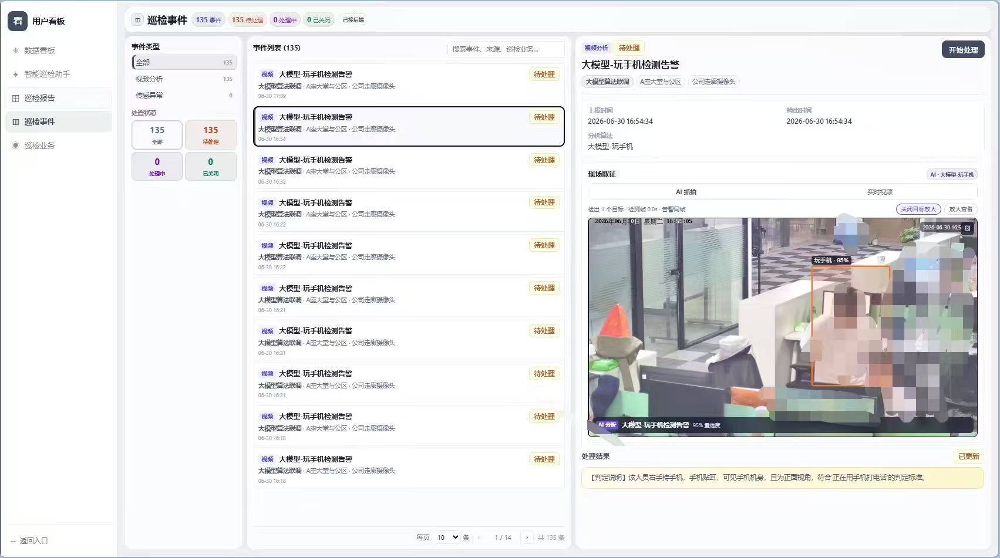
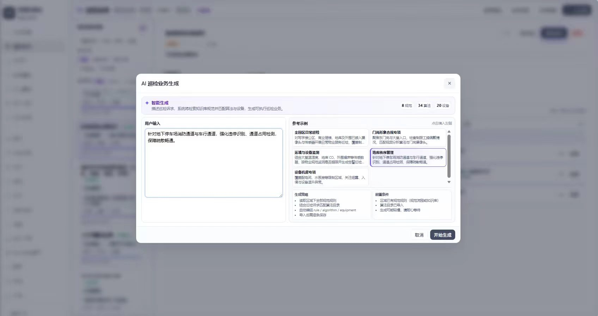
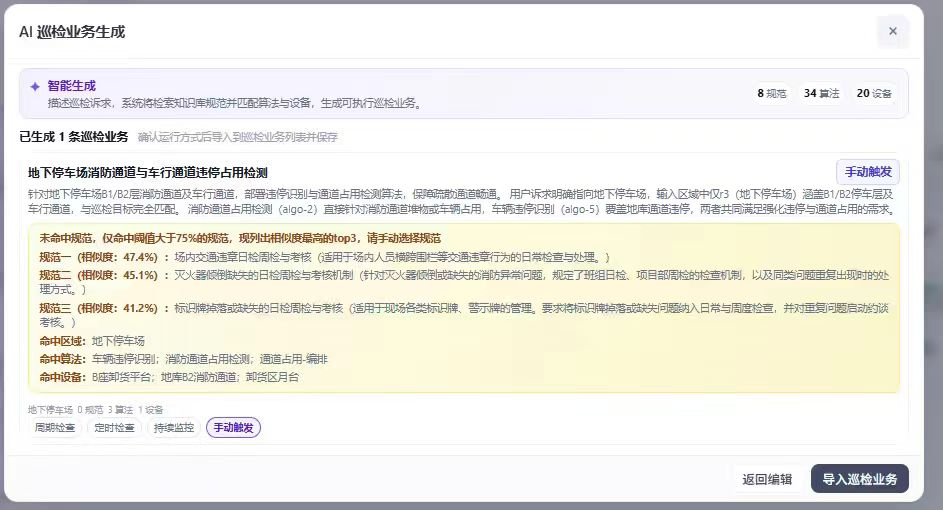
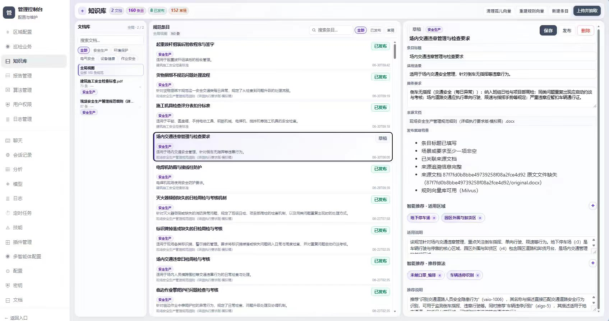
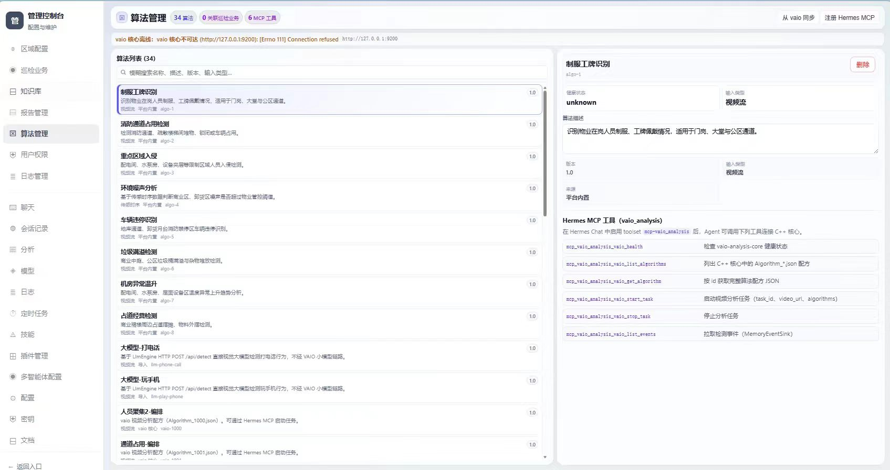
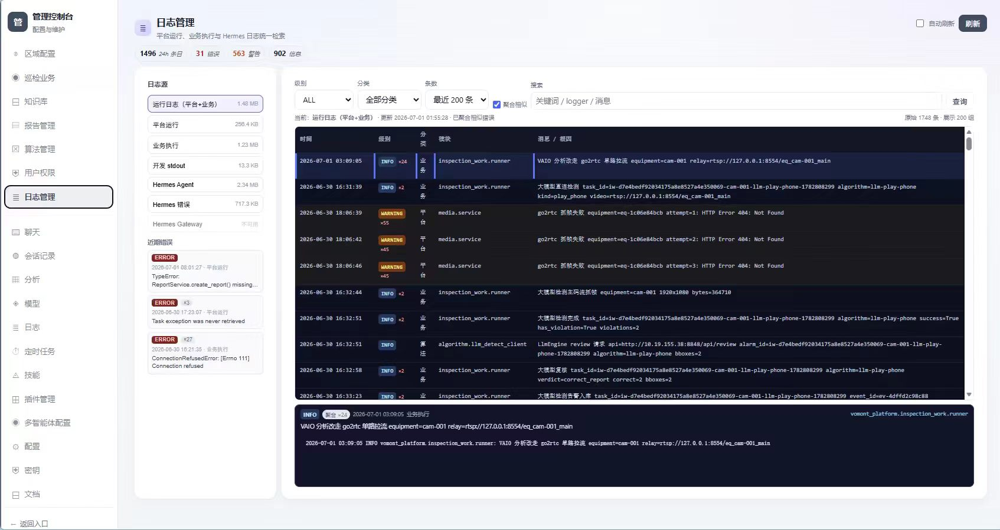

# Inspection Agent Platform

面向物业与园区场景的智能巡检 Agent 平台，将大模型 Agent 能力与区域、设备、规范、算法、巡检业务、事件与报告等业务实体打通，提供用户看板与管理控制台两套 Web 界面。

---

## 项目定位

本仓库包含三层能力，可独立理解、也可组合部署：

| 模块 | 说明 |
|------|------|
| **agent_base** | Agent 框架：多模型调度、ReAct 推理、工具调用、记忆管理、RAG、提示词管理 |
| **inspection_platform** | 业务平台后端：FastAPI + SQLite（分域分库）+ 文档/向量检索，提供 REST API 与静态资源托管 |
| **webui** | 前端：React 18 + TypeScript + Vite，用户看板与管理控制台 |

产品侧统一使用「巡检」相关表述（巡检业务、巡检事件、巡检报告等）；代码与 API 标识为 `inspection_work`、`inspection_event`、`inspection_report` 等。

---

## 核心功能

### 用户看板（`/user/*`）

- **数据看板**：KPI、巡检事件趋势、分类分布、本周巡检执行、最新报告摘要
- **触发任务**：自然语言描述 → Agent 编排流程草案 → 配置时间/业务/区域/负责人 → 执行跟踪
- **巡检报告**：报告列表、详情、计划与生成（含 PDF 导出）
- **巡检事件**：事件列表、筛选与处置状态
- **巡检业务**：业务运行态展示

### 管理控制台（`/admin/*`、`/chat`、`/docs`）

- **巡检业务工作室**：业务编排、设备与算法绑定、ROI 配置等
- **区域与设备**：区域树、设备台账、传感读数
- **知识库 / 规范**：文档向量化、规范规则抽取与发布、向量检索
- **算法管理**：算法目录与场景配置
- **用户权限**：按用户 ACL（`p-*` 权限点）配置
- **Agent 对话**：SSE 流式 ReAct，工具卡片展示
- **文档库 / 规范流程演示**：文档上传与规范工作流

### Agent 能力（`agent_base`）

- `SimpleAgent`：单轮/多轮对话
- `ReActAgent`：Thought → Action → Observation 循环，支持流式事件（推理、工具、最终回答）
- `ToolRegistry`：可扩展工具注册与执行
- `ModelManager`：多模型配置与路由
- `HybridMemoryContextManager`：上下文与记忆注入
- RAG：基于 Chroma 的分块检索（知识库、规范规则等）

---

## 技术栈

| 层级 | 技术 |
|------|------|
| 后端 | Python 3.10+、FastAPI、Uvicorn、Pydantic、SQLite、Chroma、httpx |
| 前端 | React 18、React Router 6、TypeScript、Vite 5 |
| Agent | 自研 `agent_base`（兼容 OpenAI 风格 Chat API 的 LLM 接入） |
| 向量库 | Chroma（默认）、Milvus（可选） |
| 存储 | `data/` 下按域 SQLite；文档原文 `files/`；向量索引 `data/*_chroma/` |

---

## 仓库结构

```
Inspection-Agent-Platform/
├── agent_base/              # Agent 框架（LLM、记忆、RAG、工具、提示词）
├── inspection_platform/     # 平台后端（各业务域 service + routes + static）
├── webui/                   # 前端源码
├── tests/                   # 测试
├── scripts/                 # 辅助脚本
├── pyproject.toml           # Python 包与依赖
├── .env.example             # 环境变量模板
├── .gitignore               # Git 忽略规则
└── openapi.json             # API 描述（可导入调试）
```

> 注：`data/`、`logs/`、`vaio-analysis-service/x86_64/` 等运行时数据与二进制未纳入版本控制，详见 `.gitignore`。

---

## 快速开始

### 环境要求

- Python **3.10+**
- Node.js **18+**（仅前端开发/构建时需要）

### 1. 安装 Python 依赖

在仓库根目录执行：

```bash
pip install -e .
# 开发依赖（可选）
pip install -e ".[dev]"
```

### 2. 配置环境变量

复制模板并根据实际环境修改：

```bash
cp .env.example .env
```

关键配置项：

| 变量 | 说明 |
|------|------|
| `DATABASE_URL` | MySQL 连接串（默认使用 SQLite 时无需修改） |
| `MILVUS_HOST` / `MILVUS_PORT` | Milvus 向量库地址（可选） |
| `SIA_PLATFORM_HOST` / `SIA_PLATFORM_PORT` | 后端监听地址与端口 |
| `SILICONFLOW_API_KEY` / `SILICONFLOW_CHAT_BASE_URL` | LLM API 密钥与地址 |
| `SILICONFLOW_EMBED_API_KEY` / `SILICONFLOW_EMBED_BASE_URL` | Embedding API 密钥与地址 |

### 3. 启动后端

```bash
python -m uvicorn inspection_platform.app.main:app --host 127.0.0.1 --port 8001 --reload
```

- API 文档：<http://127.0.0.1:8001/docs>
- 健康检查：`GET /api/health`

首次启动会在 `data/` 下初始化各业务 SQLite；可通过 `POST /api/auth/seed/builtin` 导入内置演示用户与权限。

### 4. 启动前端（开发模式）

```bash
cd webui
npm install
npm run dev
```

按 Vite 提示访问（通常 <http://127.0.0.1:5173>），API 代理或环境需指向后端 `8001`。

### 5. 生产/一体部署

```bash
cd webui
npm install
npm run build
```

构建产物位于 `webui/dist/`，可由 FastAPI 静态文件中间件托管（已配置在 `inspection_platform/app/main.py` 中）。

---

## 核心流程示例

### 自然语言创建巡检业务

1. 用户在对话页输入：「每天上午 9 点检查 A 区域消防通道占用情况」
2. Agent 解析意图，调用规范检索、算法绑定、设备匹配等工具
3. 生成巡检业务草案并返回前端确认
4. 用户确认后创建业务，进入调度与执行跟踪

### 规范规则抽取与发布

1. 上传安全规范 PDF/Word
2. 后端进行文本分块与向量化
3. 抽取规则条目并人工校验
4. 发布为可检索的规范库，供 Agent 与业务编排使用

---

## 界面截图

| 页面 | 截图 |
|------|------|
| 用户看板 · 巡检事件（事件列表与处置详情） |  |
| 触发任务 · AI 巡检业务生成（自然语言输入） |  |
| 触发任务 · AI 巡检业务生成（草案确认与导入） |  |
| 管理控制台 · 知识库（规范条目管理） |  |
| 管理控制台 · 算法管理（算法目录与 MCP 工具） |  |
| 管理控制台 · 日志管理（平台与 Agent 日志检索） |  |

---

## 测试

```bash
pytest
```

---

## 许可证

[MIT](LICENSE)

---

## 作者

Shi Yangbo
